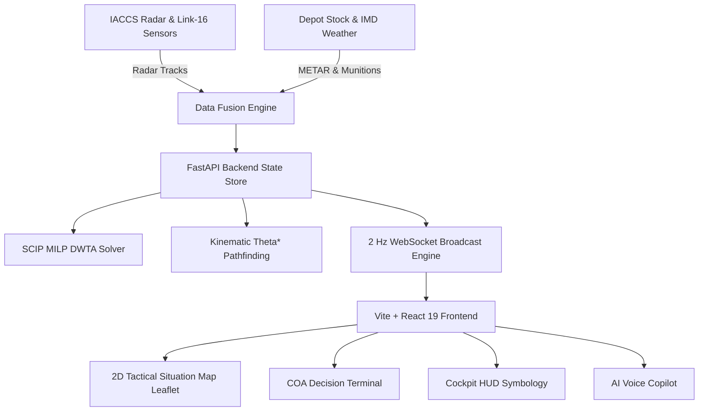

# PROJECT VAYU-NET (AD-DSS)
### Intelligent Air Defence Decision Support System & Dynamic Air Tasking Engine

[](https://sih.gov.in)
[](https://fastapi.tiangolo.com)
[](https://developers.google.com/optimization)
[](https://react.dev)
[](https://www.typescriptlang.org)
[](https://leafletjs.com)

---

## 🦅 Operational Overview
**PROJECT VAYU-NET (AD-DSS)** solves the high-stakes problem of **planning and dynamically retasking air operations in contested, rapidly shifting operational environments**. 

Information on aircraft readiness, crew duty cycles, ordnance configurations, airspace reservations, weather exclusions, and pop-up enemy anti-access/area-denial (A2/AD) threats is synthesized into an authoritative, real-time Common Operating Picture (COP) backed by mathematical optimization and explainable AI.

---

## ⚡ Key Capabilities

### 1. Mathematical Dynamic Weapon-Target Assignment (DWTA)
- Solved via **Google OR-Tools SCIP Mixed-Integer Linear Programming (MILP)** in **sub-15 milliseconds**.
- Multi-objective optimization maximizing priority score fulfillment while penalizing surface-to-air missile (SAM) threat exposure and combat radius fuel consumption:
  $$\max \sum_{i} \sum_{j} \left( w_1 P_j - w_2 R_{ij} - w_3 D_{ij} \right) x_{ij}$$
- Satisfies hard constraints: 1-to-1 sortie assignment, combat radius margins, pilot Flight Duty Limitations (FDL), and payload role compatibility.

### 2. Kinematic Theta* Any-Angle Pathfinding & Deconfliction
- Sub-grid, line-of-sight path planning avoiding enemy SAM engagement bubbles (S-400, HQ-9B) and severe Cumulonimbus (CB) storm cells.
- Enforces aerodynamic turn-radius constraints derived from aircraft $g$-limits:
  $$R_{\min} = \frac{v^2}{g \sqrt{n_{\max}^2 - 1}}$$

### 3. Asynchronous 2 Hz Real-Time Telemetry Engine
- Streams live coordinates, true airspeeds, Mach readings, G-loads, fuel burn, and tactical warnings over high-throughput WebSockets.

### 4. MIL-STD-1787C Glass-Cockpit Heads-Up Display (HUD)
- Pitch ladder ($-10^\circ$ to $+10^\circ$), artificial horizon, calibrated airspeed tape, barometric altitude tape, magnetic heading tape, BVR target intercept reticle with shoot cues, and $360^\circ$ Radar Warning Receiver (RWR) threat rose.
- Phosphor modes: NVG Green, Tactical Cyan, and Amber Night Vision.

### 5. Tactical AI Air Dispatcher & Voice Copilot
- Natural language speech recognition (Web Speech API) & synthesized military voice readouts.
- Automated evaluation of strike packages, pilot fatigue, BINGO fuel margins, and runway denial contingencies.

### 6. War Game "What-If" Scenario Stress-Test Sandbox
- Realistic simulated crises:
  - **Runway Denial Strike**: Halwara runway cratered by ballistic impact $\rightarrow$ automatic diversion to Bareilly/Ambala.
  - **Low-RCS Drone Swarm Ingress**: 4 low-observable loitering UAVs skimming at 1,500ft AGL $\rightarrow$ multi-target weapon allocation.
  - **Severe Convective Cloud Burst**: Violent 75km CB storm front $\rightarrow$ terrain-masking corridors.
  - **In-Flight Mayday Emergency**: Su-30MKI hydraulic failure and 650kg critical BINGO fuel.

### 7. Link-16 / IACCS Tactical Data Link Monitor
- Joint Tactical Information Distribution System (JTIDS / TADIL-J) telemetry:
  - 77,000 hops/sec Frequency Hopping Spread Spectrum (FHSS)
  - 38.4 dB Anti-Jam margin
  - KGV-72 Type-1 Cryptographic key rollover
  - J-Series message stream: J2.2 PPLI, J3.2 Air Track, J12.0 Mission Assignment.

---

## 🛠️ System Architecture



---

## 🚀 Quickstart Guide

### Prerequisites
- Python 3.10+
- Node.js 18+ & npm

### 1. Backend Server Setup
```bash
# Navigate to repository root
cd defence

# Install Python dependencies
pip install -r backend/requirements.txt

# Start FastAPI production server (runs on port 8000)
python3 -m uvicorn backend.main:app --host 0.0.0.0 --port 8000 --reload
```

### 2. Frontend Tactical C2 Interface Setup
```bash
# Navigate to frontend
cd frontend

# Install dependencies
npm install

# Start Vite dev server (runs on port 5173)
npm run dev
```

Open **`http://localhost:5173`** in your browser.

---

## 📡 API Endpoints

| Method | Endpoint | Description |
|---|---|---|
| `GET` | `/api/v1/state` | Full theater state snapshot (Fleet, Airbases, SAMs, Weather, DEFCON) |
| `POST` | `/api/v1/optimize` | Runs SCIP MILP solver, returns 3 ranked deconflicted COAs |
| `POST` | `/api/v1/inject-threat` | Injects pop-up SAM threat & triggers sub-15ms replanning |
| `POST` | `/api/v1/scenario/inject` | Injects crisis war games (Runway Denial, Drone Swarm, etc.) |
| `POST` | `/api/v1/coa/authorize` | Authorizes tactical COA order and transmits scramble vectors |
| `POST` | `/api/v1/copilot/query` | Explainable AI tactical advisor with voice script |
| `POST` | `/api/v1/simulation/control` | Controls simulation speed (1x, 2x, 5x) and play/pause |
| `POST` | `/api/v1/reset` | Restores theater to baseline T+00:00 |
| `WS` | `/ws/telemetry` | High-frequency 2 Hz WebSocket streaming live kinematics |

---

## 🛡️ License
Government / Smart India Hackathon Operational Use. Developed for Indian Air Force (IAF) Air Operations Decision Support.
